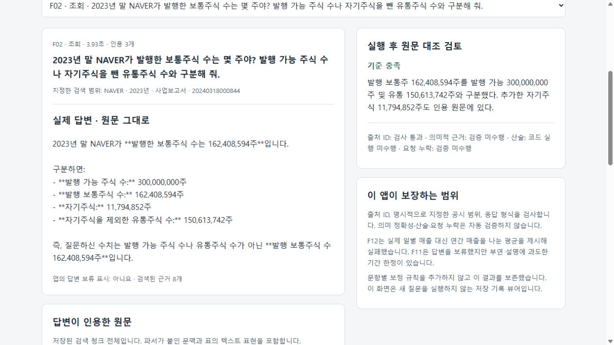
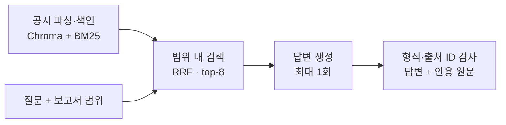

# DART Filing RAG

**DART 공시의 표와 본문을 검색하고, 답변과 인용 원문을 함께 확인하는 문서 질의응답 시스템입니다.**

문서 구조를 보존하는 파서와 하이브리드 검색을 구현하고, 직접 구축·검수한
**11개 기업·77문항**의 공시 QA 데이터셋으로 검색 누락·표 해석·답변 오류를 분석했습니다.

**[웹 데모 보기](https://woojune511.github.io/dart-rag-agent/)** ·
[아키텍처와 설계 판단](docs/overview/project_overview.md) ·
[평가 결과와 한계](docs/evaluation/README.md) ·
[로컬 실행](docs/operations/quickstart.md)

[](https://woojune511.github.io/dart-rag-agent/)

*2026-09-22 실행에서 선정한 F02의 저장 화면입니다. 데모에서 조회·계산·보류·실패
5개 사례와 인용 원문을 살펴볼 수 있습니다. 새 질문 입력이나 모델 호출은 없습니다.*

## 주요 구현

- **공시 구조를 보존하는 ingest:** 절 제목, 표의 행·열·단위, 공시 식별자를
  검색 문맥에 남깁니다. [파서](src/processing/financial_parser.py) ·
  [표 레코드](src/processing/table_records.py)
- **보고서 범위를 지키는 하이브리드 검색:** Chroma dense와 BM25에 같은 명시적
  필터를 적용하고 RRF로 순위를 결합합니다. [검색 구현](src/storage/vector_store.py) ·
  [범위 필터](src/storage/report_scope_filter.py)
- **답변에서 근거까지 이어지는 실행 경로:** 검색 1회, 답변 생성 최대 1회 후
  응답 형식·출처 ID를 검사하고 답변·인용 원문·검증 한계를 함께 반환합니다.
  [SimpleRagAgent](src/agent/simple_rag.py) · [API 서비스](src/api/services.py)
- **데이터셋 구축과 실패 분석:** 수치 22개, 요약·혼합 36개, 거절 19개 문항을
  구성하고 실제 전달 근거와 답변을 대조했습니다. 평가 기준 자체의 대상·범위
  오류도 별도로 기록했습니다. [데이터셋](benchmarks/datasets/single_doc_eval_full.curated.json) ·
  [설계 근거](docs/evaluation/benchmark_dataset_design.md)

## 동작 구조



FastAPI와 Streamlit은 같은 `SimpleRagAgent` 서비스를 사용합니다. 근거가 비어
있으면 답변 생성 없이 보류합니다. 산술·의미적 근거·요청 항목의 완전성은 자동
검증하지 않으며 응답에 이를 표시합니다. [실행 계약](docs/architecture/agent_runtime_contract.md)

**기술 구성:** Python 3.13 · FastAPI · Streamlit · LangChain · Chroma · BM25/RRF

## 공개 전체 평가 · 2026-09-28

자체 구축한 11개 기업·77문항에서 저장된 답변과 실제 전달·인용 근거를
assistant가 원문 대조했습니다. 통과는 정확성·필수 항목 충족·출처 지지를 모두
만족한 경우입니다.

| 항목 | 결과 |
| --- | --- |
| 실행 완료 / 오류 | 77/77 완료 · 오류 0건 |
| 답변 가능 문항 | 30/55 통과 |
| 거절 문항 | 18/19 통과 |
| 평가 기준 충돌 | 최초 3문항 제외 · 후속 검토에서 1문항 추가 확인 |

추가 충돌 문항까지 제외하면 답변 통과는 **30/54**입니다. 과거 30/55 기록을
덮어쓰지 않습니다. 개발에 노출된 자체 데이터셋의 사후 검토이며, 독립 사람 평가나
새 회사에 대한 일반화 정확도는 아닙니다. 77/77은 실행 완료 수입니다.

[전체 결과·문항별 실패 분석](docs/evaluation/simple_rag_full77_result.md) ·
[평가별 조건과 분모](docs/evaluation/README.md)

## 실험에서 내린 설계 판단

| 판단 | 관측한 근거 |
| --- | --- |
| 기본 경로를 Simple RAG로 단순화 | 4문항 비교에서 Planner/Compiler의 명확한 품질 우위 없이 추정 비용 3.47배·측정 시간 4.79배. [비교 보고서](docs/evaluation/portfolio_workflow_comparison_successor.md) |
| Dense와 BM25를 결합 | 별도 12문항 비교의 답변형 9개에서 완전·정확·원문 지지 답변은 hybrid 9/9, dense-only 5/9. [비교 조건](docs/evaluation/vanilla_dense_comparison.md) |
| 표 구조의 효과를 사례별로 분석 | 77문항 3조건 비교에서 일부 표 경계를 복구했지만 전체 답변 통과는 일반 텍스트가 더 높았습니다. [구조 비교](docs/evaluation/structure_full77_result.md) |

서로 다른 개발 노출 실험입니다. 결과를 합산하거나 구조·검색 방식의 일반적 우위로
해석하지 않습니다. Planner/Compiler는 명시적 비교·replay 경로에 남아 있습니다.

## 직접 확인하기

- **설치 없이 보기:** [웹 데모](https://woojune511.github.io/dart-rag-agent/)에서
  `조회 성공 → 인용 원문 → 실패 사례` 순서로 살펴보세요.
- **오프라인으로 보기:** 저장소를 내려받아 [demo/index.html](demo/index.html)을
  브라우저로 엽니다. [데모 안내](demo/README.md)
- **앱 실행:** Python·API 키·호환 store를 준비하는 [로컬 실행 안내](docs/operations/quickstart.md)를 따릅니다.

데모 데이터의 무결성은 Python 표준 라이브러리만으로 확인할 수 있습니다.

```bash
python -I -S demo/verify.py
```

이 검사는 저장된 사례의 파일 무결성을 확인합니다. 검색·생성 재실행이나 답변 품질
검증은 아닙니다.

[문서 지도](docs/README.md) · [코드 탐색](docs/overview/codebase_map.md) ·
[검증 상태](docs/overview/project_status.md) ·
[과거 Compiler 자료](docs/overview/demo_walkthrough.md)
