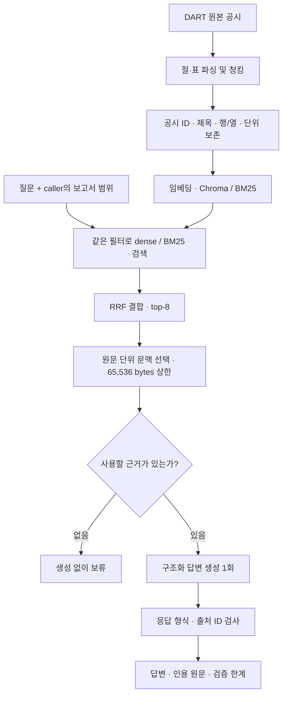

# 아키텍처와 설계 판단

DART 공시의 표와 본문에서 근거를 검색하고, 답변과 인용 원문을 함께 제공하는
문서 QA 애플리케이션입니다. 기본 제품은 `SimpleRagAgent`이며 FastAPI와
Streamlit이 같은 서비스를 사용합니다.

[프로젝트 홈](../../README.md) · [저장 사례 데모](https://woojune511.github.io/dart-rag-agent/) ·
[평가와 한계](../evaluation/README.md) · [로컬 실행](../operations/quickstart.md)

## 해결하려는 문제

공시에는 비슷한 항목 이름과 여러 기간·단위·연결/별도 수치가 함께 등장합니다.
검색한 숫자가 원문에 존재해도 질문의 대상과 기간에 맞는 값이라는 보장은 없습니다.
문서 구조와 보고서 범위를 보존하고, 어떤 근거로 답했는지 직접 확인할 수 있게 합니다.

## 수집에서 답변까지

질문에 적힌 회사·연도를 코드가 추정해 검색 범위를 바꾸지 않습니다. 명시적 범위를
검색 전과 검색 결과에 적용하며, 다른 보고서의 근거가 섞이면 실패 처리합니다.
문맥은 원문 청크 전체 단위로 선택하고 제외 이유를 남깁니다. 검색의 query embedding과
수집 단계의 호출은 답변 생성 1회와 별개입니다.

## 구현을 읽는 순서

| 관심사 | 구현 | 확인할 점 |
| --- | --- | --- |
| 문서·표 파싱 | [financial_parser.py](../../src/processing/financial_parser.py), [table_records.py](../../src/processing/table_records.py) | 절·표·행/열·단위와 공시 식별자 보존 |
| 근거 검색 | [vector_store.py](../../src/storage/vector_store.py), [report_scope_filter.py](../../src/storage/report_scope_filter.py) | 동일 scope의 dense/BM25, RRF, 중복·출처 처리 |
| 답변 실행 | [simple_rag.py](../../src/agent/simple_rag.py), [응답 schema](../../src/config/simple_rag.py) | 한 번의 답변 생성, 인용 검사, 보류·검증 한계 |
| 앱 연결 | [services.py](../../src/api/services.py), [financial_router.py](../../src/api/financial_router.py), [app.py](../../app.py) | 공통 서비스와 API·Streamlit 경계 |
| 평가 설계 | [데이터셋](../../benchmarks/datasets/single_doc_eval_full.curated.json), [설계 근거](../evaluation/benchmark_dataset_design.md) | 수치·요약/혼합·거절 구성, 정답·근거·평가 기준 |

세부 책임은 [코드 지도](codebase_map.md), 동작 규칙은
[runtime contract](../architecture/agent_runtime_contract.md)가 정의합니다.

## 왜 이렇게 설계했는가

| 선택 | 근거와 한계 |
| --- | --- |
| 기본 경로를 단순 RAG로 축소 | 4문항의 고정 근거 비교에서 Planner/Compiler는 추정 비용 3.47배·측정 시간 4.79배였지만 품질 우위가 명확하지 않았습니다. [채택 결정](../architecture/simple_rag_adoption.md) |
| Hybrid retrieval 유지 | 같은 모델·prompt/schema·top-8의 12문항 비교에서 답변형 통과는 hybrid 9/9, dense-only 5/9였습니다. Dense arm은 저장 vector replay이므로 live 지연시간 비교는 아닙니다. [보고서](../evaluation/vanilla_dense_comparison.md) |
| 구조 보존 효과를 따로 검토 | 77문항 비교에서 표 경계·범위 복구 사례가 있었지만 일반 텍스트 조건의 전체 통과가 더 높았습니다. 추출·청킹·문맥량도 달라 구조만의 인과 효과로 해석하지 않습니다. [보고서](../evaluation/structure_full77_result.md) |

이 선택들은 개발에 노출된 제한된 실험의 결과입니다. 실패 문항마다 개별 규칙을
추가하는 대신 원문 보존, 검색 누락, 대상·기간 해석, 근거 없는 부가 설명을 나눠
분석했습니다. [전체 평가와 실패 경계](../evaluation/README.md)

## 보장하는 범위

앱은 명시적 보고서 범위, 응답 형식, 인용한 출처 ID를 검사합니다. 출처 ID가
맞아도 답변의 의미·기간·대상이 맞는다는 뜻은 아닙니다. 산술을 코드로 실행하지
않고, 의미적 근거와 요청 항목의 완전성도 자동 검증하지 않습니다.

`FinancialAgent`의 Planner/Compiler와 계산 검증은 명시적 비교·replay 전용입니다.
기본 앱의 자동 fallback이 아니며 해당 보장은 [별도 계약](../architecture/compiled_workflow_contract.md)에 있습니다.
